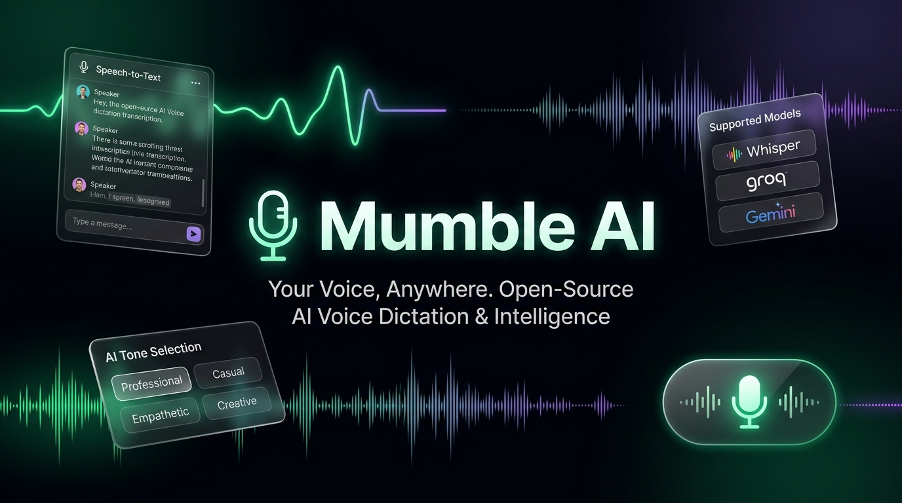
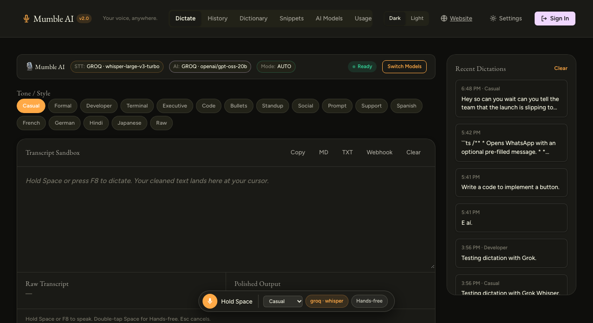
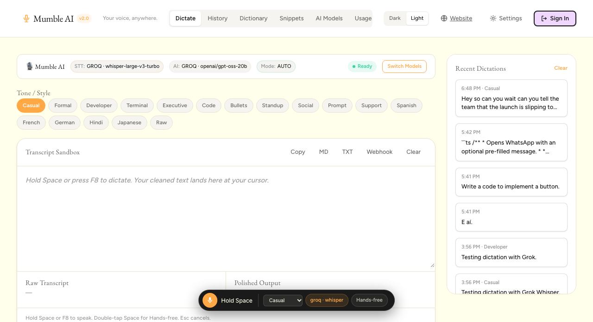
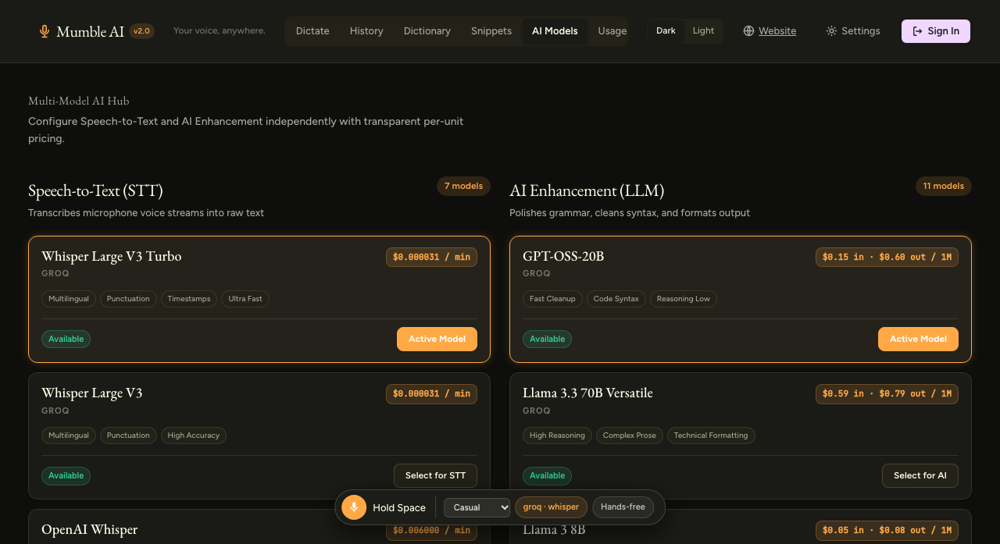
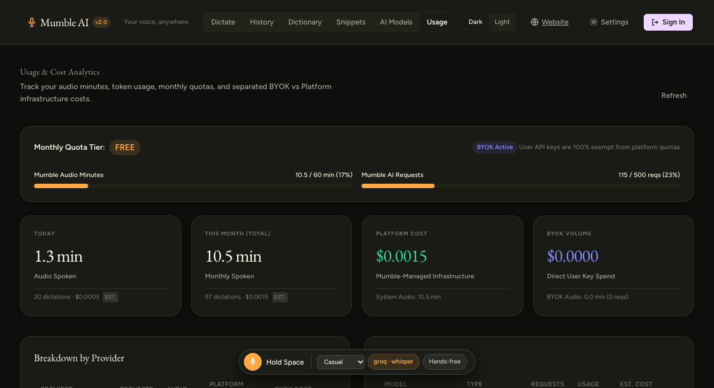
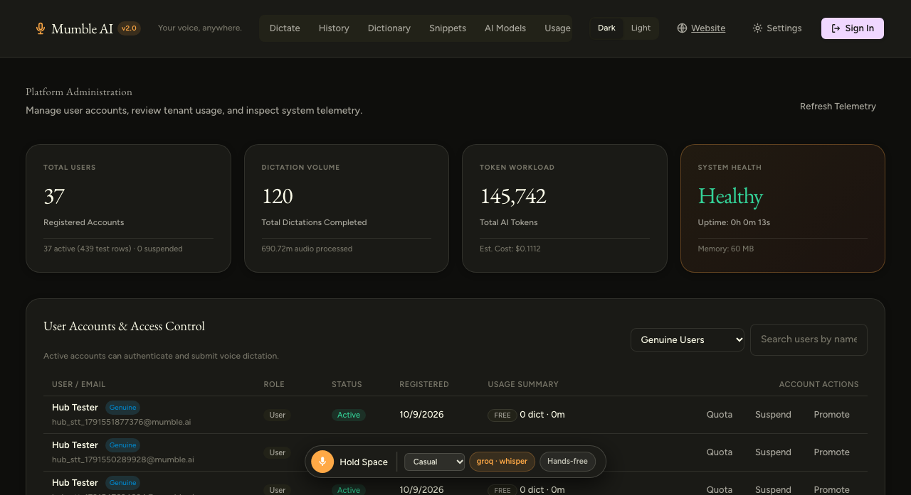
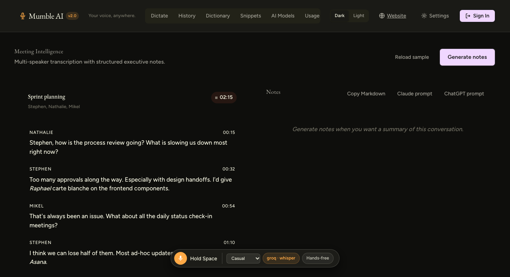
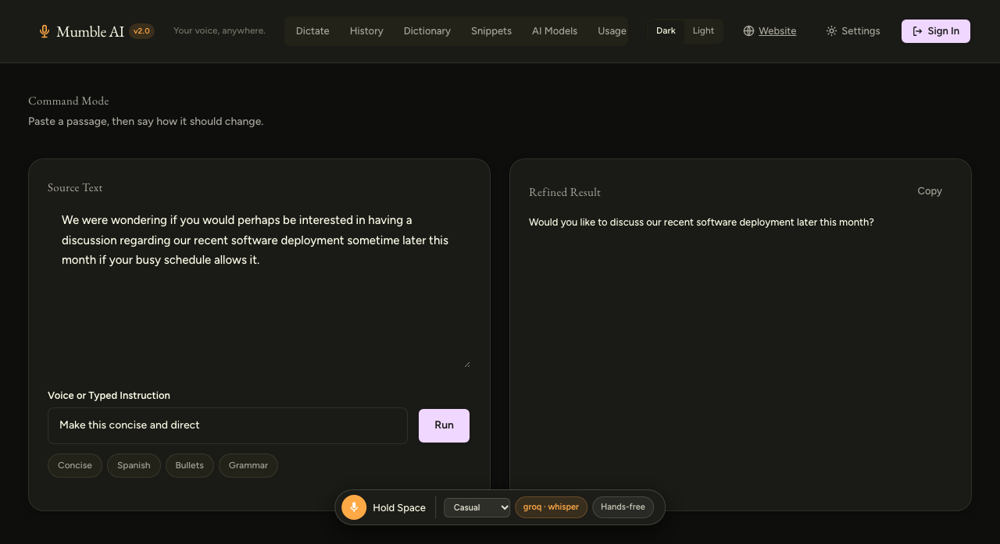
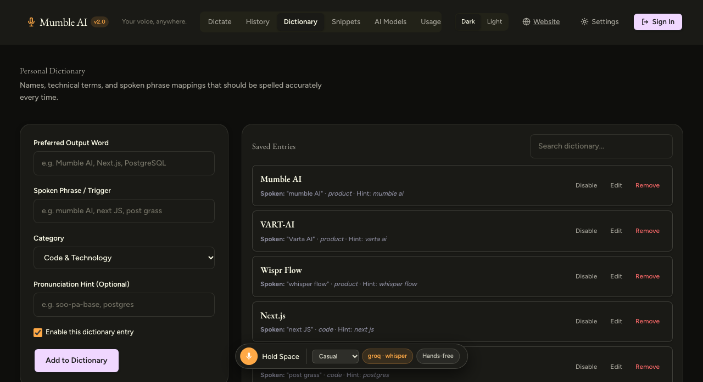

<div align="center">



# 🎙️ Mumble AI

**The Open-Source, Self-Hostable AI Voice Dictation & Intelligence Platform**

*Speak naturally. Get polished, zero-edit writing anywhere on your computer.*

[](https://github.com/maaz-ahmad-63/mumble_flow)
[](LICENSE)
[](https://nodejs.org/)
[](https://www.electronjs.org/)
[](https://groq.com)
[](https://groq.com)

[Architecture](#-architecture--modalities) •
[Visual Tour](#-visual-tour--features) •
[Quickstart](#-quickstart-guide) •
[Desktop Companion](#-desktop-companion-electron--global-hotkeys) •
[Model Hub & BYOK](#-model-hub--bring-your-own-keys-byok) •
[Deployment](#-production-deployment) •
[Security](#-security--encryption)

---

</div>

**Mumble AI** is a voice-first productivity platform and the open-source alternative to Wispr Flow. Speak the way you naturally talk—with pauses, "ums", and mid-thought self-corrections—and Mumble AI transforms raw speech into structured, publication-ready text in milliseconds.

Works across both a **full-featured Web Studio** and a **system-wide Desktop Companion** that types into Slack, Cursor, VS Code, Gmail, Word, Terminal, and any other application via push-to-talk.

---

## 🏗️ Architecture & Modalities

Mumble AI is engineered around decoupled, high-performance interfaces:

```text
 ┌────────────────────────────────────────────────────────┐
 │                   MUMBLE AI CLIENTS                    │
 ├────────────────────────────┬───────────────────────────┤
 │  🌐 Browser Web Studio     │  🖥️ Native Desktop App    │
 │  - Real-time waveforms     │  - Electron + OS Hooks    │
 │  - Split diff transcript   │  - Push-to-Talk (Hold     │
 │  - Model Hub & BYOK keys   │    Space / F8)            │
 │  - RBAC Admin Dashboard    │  - App-aware context      │
 │  - Meeting Notetaker       │  - Native text injection  │
 └─────────────┬──────────────┴─────────────┬─────────────┘
               │                            │
               │ HTTP / Duplex WebSocket    │
               ▼                            ▼
 ┌────────────────────────────────────────────────────────┐
 │               MUMBLE AI CORE BACKEND                   │
 │   Express Server • Native node:sqlite in WAL Mode      │
 ├────────────────────────────────────────────────────────┤
 │ • Multi-User Auth & Session Management (HMAC-SHA256)   │
 │ • Model Hub Engine (Groq, Gemini, OpenAI, Local)       │
 │ • BYOK Authenticated Encryption at Rest (AES-256-GCM)  │
 │ • Zero-Edit Engine & App-Aware Tone Heuristics         │
 │ • Usage Tracking, Platform Cost Separation & Quotas    │
 │ • Streaming WebSocket Dictation Pipeline (/ws/dictate) │
 └────────────────────────────────────────────────────────┘
```

| Dimension | 🌐 Web Studio & Dashboard | 🖥️ Desktop Companion (Electron) |
| :--- | :--- | :--- |
| **Primary Role** | Interactive audio sandbox, meeting diarization, Model Hub, Usage Analytics, and Admin Control | System-wide push-to-talk overlay that directly types into active foreground apps |
| **Execution** | Chrome, Edge, Safari, Firefox via local or remote HTTPS | Native desktop app (macOS, Windows, Linux) living in the system tray |
| **Input Capture** | WebRTC in-browser recording (<kbd>Hold Space</kbd> or Hands-free) | Global OS keyboard listener (<kbd>Hold Space</kbd> or <kbd>F8</kbd>) + 16kHz audio capture |
| **Text Output** | Transcript sandbox with live split diffs and clipboard sync | Injected directly into cursor focus (Slack, Cursor, VS Code, Word, Terminal) |
| **Backend Sync** | Direct local/remote REST API and WebSocket streaming | Communicates over local loopback (`localhost:3050`) or remote backend URL |

---

## 📸 Visual Tour & Features

### 1. Zero-Edit Dictation Studio & Live Split Diff
Speak freely with hesitations and false starts. The zero-edit pipeline strips verbal clutter, corrects grammar, and accurately resolves self-corrections (*"Let's schedule for Friday... actually Monday afternoon"* → *"Let's schedule for Monday afternoon."*).

<div align="center">

| 🌙 Dark Theme | ☀️ Light Theme |
| :---: | :---: |
|  |  |

</div>

- **Instant Diff Breakdown**: Compare raw speech heard against the cleaned, polished text.
- **Floating Island Widget**: Persistent status pill displaying real-time waveforms, active model, and recording timer.
- **15+ Tone Presets**: Casual, Formal, Developer, Terminal, Executive, Code, Bullets, Standup, Social, Prompt, Support, or instant multilingual translations (Spanish, French, German, Hindi, Japanese).

---

### 2. Multi-Model Hub & Bring Your Own Key (BYOK)
Choose between high-speed cloud inference or private local models for both Speech-to-Text and LLM enhancement.



- **Independent Model Switching**: Pair Groq Whisper STT with Gemini 3.6 Flash, or OpenAI Whisper with GPT-OSS-20B.
- **BYOK Credential Isolation**: Securely input your own API keys. Keys are encrypted at rest with AES-256-GCM and never leaked in API responses.
- **Cost Transparency**: Real-time per-unit pricing indicators for every model.

---

### 3. Usage Analytics & Cost Control
Full visibility into transcription time, token volume, and infrastructure spend.



- **BYOK vs. Platform Cost Separation**: Automatically distinguishes zero-cost BYOK requests from Mumble-managed platform spend.
- **Monthly Tier Quotas**: Configurable limits on audio minutes and LLM requests, with BYOK requests cleanly exempt.
- **Provider Telemetry**: Real-time breakdown across Groq, Gemini, and OpenAI.

---

### 4. Enterprise Administration & Access Control
Comprehensive admin dashboard powered entirely by real database records.



- **User Access Management**: Review accounts, promote roles, suspend users, and adjust quotas.
- **Genuine Account Discrimination**: Smart detection isolates synthetic test rows from authentic registered users.
- **System Health Telemetry**: Live uptime, memory consumption (RSS), and request failure monitoring.

---

### 5. Meeting Notetaker & Speaker Attribution
Capture meetings and lectures with automated diarization and zero third-party bots.



- **Multi-Speaker Diarization**: Attributed conversation timeline with speaker identification and timestamps.
- **Structured Synthesis**: Automatically extracts Executive Overviews, Key Decisions, Discussion Highlights, and Action Items.
- **1-Click Export**: Export directly as Markdown, plain text, or ready-to-run prompts for ChatGPT and Claude.

---

### 6. Voice-to-Action Command Mode & Vocabulary
Highlight drafts and command the AI to restructure, rewrite, or transform them with your voice.

<div align="center">

| ⚡ Voice Command Mode | 📖 Personal Dictionary |
| :---: | :---: |
|  |  |

</div>

- **Command Mode**: Say *"Format as executive bullets"* or *"Translate this to German"* to instantly rewrite text.
- **Personal Dictionary**: Phonetic bias ensures unusual names, technical libraries, and company jargon are transcribed accurately.
- **Voice Snippets**: Trigger phrases expand into long templates, Calendly links, or markdown boilerplates.

---

## 🚀 Quickstart Guide

### Prerequisites
- **[Node.js 20 LTS](https://nodejs.org/)** or newer (22 LTS recommended).

### 1. Clone & Start
```bash
git clone https://github.com/maaz-ahmad-63/mumble_flow.git
cd mumble_flow
npm install
npm test
npm start
```
Open **http://localhost:3050** in your browser.

### 2. Automated Setup Scripts
```bash
# macOS & Linux
bash scripts/setup.sh

# Windows (PowerShell)
powershell -ExecutionPolicy Bypass -File scripts\setup.ps1
```

### 3. Configure API Keys (Optional)
Copy `.env.example` to `.env`:
```bash
cp .env.example .env
```
Provide your keys for cloud models (free keys available at [console.groq.com](https://console.groq.com) and [aistudio.google.com](https://aistudio.google.com)).
*With zero API keys, local rule-based cleanup and dictionary features still work offline.*

---

## 🖥️ Desktop Companion (Electron & Global Hotkeys)

The Electron desktop companion provides the true Wispr Flow experience across your entire operating system.

```bash
cd desktop/electron
npm install
npm start
```

### How to Dictate:
1. **Hold <kbd>Space</kbd>** (for >300ms) anywhere on your computer to record; release to type. (Normal quick space taps type a space character normally).
2. **Press <kbd>F8</kbd>** as an alternate global push-to-talk toggle.
3. **Press <kbd>Esc</kbd>** at any time to immediately cancel recording.

### Connecting to a Deployed Backend:
The Electron app can run against a remote production server:
```bash
MUMBLE_SERVER_URL="https://your-mumble-domain.com" MUMBLE_AUTH_TOKEN="<your_jwt_token>" npm start
```

---

## 🔑 Model Hub & Bring Your Own Keys (BYOK)

Mumble AI gives you complete control over your AI providers:

| Provider | Speech-to-Text (STT) | LLM Zero-Edit Cleanup | Free Tier Available? |
| :--- | :--- | :--- | :---: |
| **Groq** | `whisper-large-v3-turbo`, `whisper-large-v3` | `openai/gpt-oss-20b`, `llama-3.3-70b` | ✅ Yes ([console.groq.com](https://console.groq.com/keys)) |
| **Google Gemini** | `gemini-3.6-flash` | `gemini-3.6-flash` | ✅ Yes ([aistudio.google.com](https://aistudio.google.com/apikey)) |
| **OpenAI** | `whisper-1` | `gpt-4o-mini`, `gpt-4o` | Pay-as-you-go |
| **Local (Ollama / Whisper)** | Self-hosted Whisper HTTP endpoint | `llama3.2` via Ollama | ✅ 100% Free & Offline |

---

## 🌐 Production Deployment

Mumble AI requires a long-running Node.js process with persistent disk storage for `data/mumble_flow.sqlite` and WebSocket support (`/ws/dictate`).

> [!NOTE]
> **Serverless Compatibility**: Mumble AI is not compatible with Vercel Serverless because persistent bidirectional WebSockets and SQLite WAL mode require a persistent disk.

### Simplest Safe Deployment: Single Docker Container
Use the included [Dockerfile](Dockerfile) on any platform with persistent volume storage:

1. **Render / Fly.io / Railway:**
   - Deploy as a Docker service.
   - Mount a persistent volume to `/app/data`.
   - Set environment secrets:
     ```bash
     NODE_ENV=production
     PORT=3050
     JWT_SECRET=<32-byte-hex-string>
     ENCRYPTION_KEY=<32-byte-hex-string>
     GROQ_API_KEY=gsk_...
     ```
2. **Ubuntu VPS with Caddy (1-Command Install):**
   ```bash
   curl -fsSL https://raw.githubusercontent.com/maaz-ahmad-63/mumble_flow/main/scripts/install-vps.sh | sudo bash
   ```
   Caddy automatically provisions SSL (required for microphone access) and proxies WebSockets.

---

## 🔒 Security & Encryption

- **Authenticated Encryption at Rest**: BYOK keys are encrypted using **AES-256-GCM** with a server-side master key (`ENCRYPTION_KEY`). Decrypted keys are never logged or exposed in client responses.
- **Cryptographic Password Storage**: Passwords are hashed using `scrypt` with unique cryptographically random salts.
- **Tenant Isolation**: Multi-tenant architecture ensures strict user isolation across dictionary, snippets, history, usage metrics, and BYOK credentials.
- **RBAC Guards**: Admin endpoints are strictly guarded with `requireAuth` and `requireAdmin` middleware.

---

## 📁 Repository Structure

```text
client/                  Frontend Web Studio: HTML5, CSS design system, vanilla JS modules
desktop/electron/        Cross-platform Electron companion with global hotkeys & text injection
desktop/python/          Optional lightweight Python companion (F8 hotkey daemon)
server/                  Express REST API & WebSocket streaming server
server/db/               SQLite schema, WAL connection, and repositories
server/services/         Auth, BYOK crypto, usage tracking, quotas, transcription, zero-edit
server/providers/        Extensible provider adapters (Groq, Gemini, OpenAI, Local)
server/streaming/        Duplex WebSocket audio streaming pipeline (/ws/dictate)
tests/                   Comprehensive test suites (26 suites covering unit, e2e, security)
scripts/                 Automated setup and VPS provisioning scripts
docs/                    Detailed platform guides and deployment documentation
```

---

## 🧪 Testing & Validation

Run the complete test suite (requires no API keys):

```bash
npm test
```

Includes 26 suites verifying SaaS authentication, BYOK encryption, usage calculation, quotas, concurrent request load, and app-aware dictation accuracy.

---

## 📄 License

Distributed under the [MIT License](LICENSE).  
Copyright © 2026 Mumble AI Contributors.
